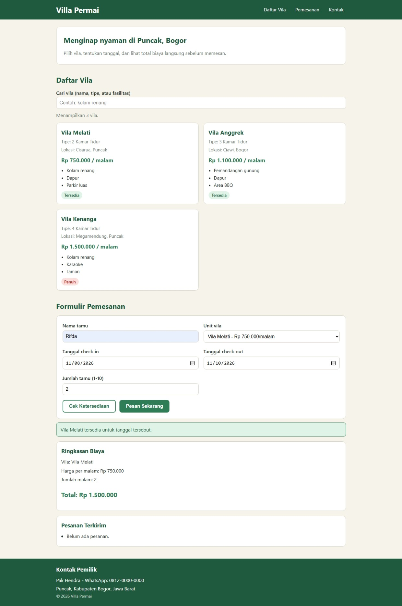

# Villa Permai - Aplikasi Pemesanan Vila

- **Nama:** Rifda Zalfa Yanuarizka
- **NIM:** 24011130479
- **Repository:** uts-vila-permai-24011130479
- **Mata kuliah:** Teknologi Web (UTS)

## Deskripsi
Halaman web statis (HTML, CSS, JavaScript) untuk memesan vila di Puncak, Bogor. Tanpa server dan tanpa basis data; data vila disimpan sebagai array objek di `script.js`.

Demo online: https://zalfarifda.github.io/uts-vila-permai-24011130479/

## Cara Menjalankan
1. Unduh atau clone repository ini.
2. Buka file `index.html` di browser (atau gunakan ekstensi Live Server di VS Code).

## Daftar Fitur
- [x] Tiga kartu vila dirender dari array objek JavaScript (createElement/appendChild)
- [x] Pencarian vila berdasarkan kata kunci
- [x] Dropdown unit vila otomatis dari data
- [x] Perhitungan total biaya otomatis (harga per malam x jumlah malam)
- [x] Validasi form dengan pesan berbahasa Indonesia
- [x] Penyimpanan nama terakhir dan daftar pesanan di localStorage
- [x] Desain responsif (breakpoint 768px dan 480px)
- [ ] Pembayaran online (belum tersedia)
- [ ] Pengecekan jadwal bentrok antar tamu (belum tersedia)

## Tangkapan Layar

